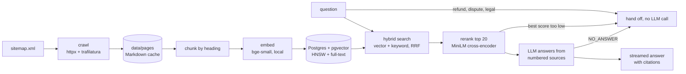

# askdocs

A support chatbot that answers from your documentation, cites the exact section it used, and says "I don't know" instead of guessing.

The demo is trained on the [Supabase guides](https://supabase.com/docs/guides) (629 pages).

> Status: crawl, indexing, hybrid search, reranking, the streaming chat API, the embeddable widget and a 53-question evaluation are done. Deployment, human handoff notifications and an admin page are next.

## How it works



- **Crawl:** reads the sitemap and saves each page's main content as Markdown. Pages are cached, so a re-run only fetches new ones. Code blocks keep their line breaks, and heading ids are saved so citations can link straight to a section (`page#create-edge-function`).
- **Chunk:** splits each page along its headings, so every chunk belongs to one section. Long sections are split on paragraph boundaries, and code blocks are never cut in half. Each chunk is embedded with its page title and section name in front.
- **Index:** Postgres with pgvector (HNSW, cosine) plus a weighted `tsvector` (title > section > body). Re-ingesting only re-embeds pages whose content changed, and swaps each page's chunks in a single transaction.
- **Search:** keyword and vector search run together and are merged with Reciprocal Rank Fusion. Keyword search finds exact names like `supabase.auth.signUp`; vector search finds questions that use different words from the docs.
- **Rerank:** a local cross-encoder re-scores the top 20 against the question. For "how do I stop users reading each other's rows", hybrid search ranked a Slack page first; the reranker puts Row Level Security first.
- **Escalate:** questions about refunds, disputed charges or legal matters (`ESCALATE_PATTERN`) go straight to a human before any search.
- **Answer or hand off:** if the best source scores below `MIN_RERANK_SCORE`, the question is off-topic and is handed off without an LLM call. Otherwise the LLM answers from numbered sources and cites them like `[1]`, or replies `NO_ANSWER`, which is never shown to the user and also triggers a handoff. Every answer is logged to an `answers` table with its reason (`answered`, `escalated`, `no_sources`, `no_answer` or `error`), so unanswered questions can be reviewed.
- **LLM:** any OpenAI-compatible API (Ollama locally; Groq, Gemini, Claude or OpenAI in production), chosen with three environment variables.

## Results

Measured on a hand-written set of 53 questions ([evals/supabase.jsonl](api/evals/supabase.jsonl)): 42 that the docs answer, each labelled with the pages that answer it and the facts a correct answer must contain, plus 11 the bot should refuse (off-topic, a prompt injection, refunds and disputed charges, a suspended account).

| Metric | gemini-3.5-flash-lite |
|---|---|
| Answer accuracy (required facts present) | **95%** (40/42) |
| Cited a page that answers the question | 90% (38/42) |
| Questions it should refuse that were handed off | **100%** (11/11) |
| Answerable questions wrongly handed off | 2% (1/42) |
| Correct page in top 5 sources | 95% (40/42) |
| Correct page ranked first | 71% (30/42) |
| Response time p50 / p95 | 1.9 s / 3.1 s |

Per-question results are in [runs/](api/runs/). Answers vary by a question or two between runs.

How the numbers got here:
1. **First run: 90%.** Building the eval found a bug that hand-testing hadn't: context assembly stopped at the first chunk shorter than 200 characters and dropped every source after it. Fixing it: **93%**.
2. **Over-generalizing.** Asked "what's your refund policy?", the bot said "we do not provide refunds", but the source only says unused *credits* are not refunded. Two fixes: questions about refunds, disputed charges or legal matters now go straight to a human (`ESCALATE_PATTERN`, checked before any search), and the prompt forbids stating a rule more broadly than its source. Three new refusal questions were added so the fix isn't tuned to one question; one of them ("my account was suspended") has no escalation keyword, and the LLM correctly declined it. Result: **95%**, and all 11 refusals handed off.

Remaining misses:
- **Retrieval:** for "what chunk size should I use for resumable uploads?", the code sample that sets `chunkSize` is not retrieved, so the bot correctly declines to guess.
- **Incomplete:** for a CORS error it says to handle preflight requests but doesn't show the headers.

```bash
uv run askdocs eval --retrieval-only        # search and gate only, ~30 s, no LLM
uv run askdocs eval --out runs/my-run.json  # full run; --resume continues after a rate limit
```

## Run it

Requires Python 3.11–3.13, [uv](https://docs.astral.sh/uv/) and Docker.

```bash
docker compose up -d                 # Postgres + pgvector on :5433
cd api
cp .env.example .env
uv sync
uv run askdocs crawl                 # ~1 min, 629 pages
uv run askdocs ingest                # embeds locally, no API key needed
uv run askdocs search "how do I stop users reading each other's rows"
```

To index a different docs site, set `SITEMAP_URL` and `URL_PREFIX` in `.env`.

Start the API (needs `ollama serve` with `qwen2.5:7b`, or another LLM set in `.env`):

```bash
uv run uvicorn askdocs.api:app --port 8000
curl -X POST localhost:8000/chat -H 'content-type: application/json' \
  -d '{"question": "what is the max upload size on the free plan?"}'
```

| Endpoint | Returns |
|---|---|
| `POST /chat` | `{answer, sources, cited, answered, handoff, timings}` |
| `POST /chat/stream` | Server-sent events: `sources`, then `token`s, then `done` |

Both take `{"question": "...", "history": [{"role": "user", "content": "..."}]}`.

### Chat widget

Open http://localhost:8000 for the demo page. To add the chat to any website:

```html
<script src="https://YOUR-API/widget.js" defer
        data-api="https://YOUR-API"
        data-title="Ask the docs"
        data-color="#2563eb"></script>
```

It's one dependency-free file in a Shadow DOM, so it works with any framework and the host page's CSS can't affect it. Answers stream in with numbered citations that link to the exact doc section, and model output is escaped before rendering. It follows the system light/dark setting and goes full-screen on phones. The page can also drive it: `AskDocs.open()` or `AskDocs.ask("question")`.

## Deploy

Production uses [Neon](https://neon.com) (serverless Postgres, pgvector included). Put the Neon connection string in `DATABASE_URL` and run `askdocs ingest`; the schema is created automatically.

## Tests

```bash
cd api && uv run pytest && node --test tests/widget.test.js
```
