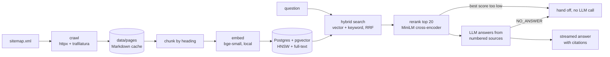

# askdocs

A support chatbot that answers from your documentation, cites the exact section it used, and says "I don't know" instead of guessing.

The demo is trained on the [Supabase guides](https://supabase.com/docs/guides) (629 pages).

> Status: crawl, indexing, hybrid search, reranking and the streaming chat API are done. The web widget, human handoff notifications, admin page and evaluation are next.

## How it works



- **Crawl:** reads the sitemap and saves each page's main content as Markdown. Pages are cached, so a re-run only fetches new ones. Code blocks keep their line breaks, and heading ids are saved so citations can link straight to a section (`page#create-edge-function`).
- **Chunk:** splits each page along its headings, so every chunk belongs to one section. Long sections are split on paragraph boundaries, and code blocks are never cut in half. Each chunk is embedded with its page title and section name in front.
- **Index:** Postgres with pgvector (HNSW, cosine) plus a weighted `tsvector` (title > section > body). Re-ingesting only re-embeds pages whose content changed, and swaps each page's chunks in a single transaction.
- **Search:** keyword and vector search run together and are merged with Reciprocal Rank Fusion. Keyword search finds exact names like `supabase.auth.signUp`; vector search finds questions that use different words from the docs.
- **Rerank:** a local cross-encoder re-scores the top 20 against the question. For "how do I stop users reading each other's rows", hybrid search ranked a Slack page first; the reranker puts Row Level Security first.
- **Answer or hand off:** if the best source scores below `MIN_RERANK_SCORE`, the question is off-topic and is handed off without an LLM call. Otherwise the LLM answers from numbered sources and cites them like `[1]`, or replies `NO_ANSWER`, which is never shown to the user and also triggers a handoff. Every answer is logged to an `answers` table, so unanswered questions can be reviewed.
- **LLM:** any OpenAI-compatible API (Ollama locally; Groq, Gemini, Claude or OpenAI in production), chosen with three environment variables.

## Run it

Requires Python 3.11–3.13, [uv](https://docs.astral.sh/uv/) and Docker.

```bash
docker compose up -d                 # Postgres + pgvector on :5433
cd api
cp .env.example .env
uv sync
uv run askdocs crawl                 # ~1 min, 629 pages
uv run askdocs ingest                # embeds locally, no API key needed
uv run askdocs search "how do I stop users reading each other's rows"
```

To index a different docs site, set `SITEMAP_URL` and `URL_PREFIX` in `.env`.

Start the API (needs `ollama serve` with `qwen2.5:7b`, or another LLM set in `.env`):

```bash
uv run uvicorn askdocs.api:app --port 8000
curl -X POST localhost:8000/chat -H 'content-type: application/json' \
  -d '{"question": "what is the max upload size on the free plan?"}'
```

| Endpoint | Returns |
|---|---|
| `POST /chat` | `{answer, sources, cited, answered, handoff, timings}` |
| `POST /chat/stream` | Server-sent events: `sources`, then `token`s, then `done` |

Both take `{"question": "...", "history": [{"role": "user", "content": "..."}]}`.

## Deploy

Production uses [Neon](https://neon.com) (serverless Postgres, pgvector included). Put the Neon connection string in `DATABASE_URL` and run `askdocs ingest`; the schema is created automatically.

## Tests

```bash
cd api && uv run pytest
```
