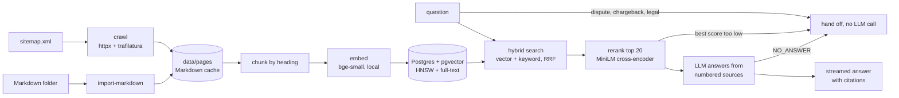

# askdocs

A support chatbot that answers from your help center or docs, links to the exact section it used, and hands off to a person instead of guessing.

**Live demo: https://askdocs-e8kq.onrender.com** (free hosting: the first question after 15 idle minutes takes about a minute while the server wakes up).

The demo is an AI support assistant for **Fernhollow Outdoor Co., a fictional outdoor-gear store** whose 37-page help center ([api/corpora/fernhollow](api/corpora/fernhollow)) covers shipping, returns, sizing, care, warranty and rewards. The help center is served at [/help](https://askdocs-e8kq.onrender.com/help), so every citation opens a real page. The same engine was first built and evaluated on 629 pages of real technical documentation (the [Supabase guides](https://supabase.com/docs/guides)).

> Status: crawling or Markdown import, indexing, hybrid search, reranking, the streaming chat API, the embeddable widget, a hosted demo and evaluations on two corpora are done. Human handoff notifications and an admin page are next.

## How it works



- **Import:** `askdocs import-markdown` turns a folder of Markdown files (one page each) into pages, with the citation URL `PUBLIC_URL/help/<slug>`; the API serves the same files as HTML help pages with matching heading anchors.
- **Crawl:** reads the sitemap and saves each page's main content as Markdown. Pages are cached, so a re-run only fetches new ones. Code blocks keep their line breaks, and heading ids are saved so citations can link straight to a section (`page#create-edge-function`).
- **Chunk:** splits each page along its headings, so every chunk belongs to one section. Long sections are split on paragraph boundaries, and code blocks are never cut in half. Each chunk is embedded with its page title and section name in front.
- **Index:** Postgres with pgvector (HNSW, cosine) plus a weighted `tsvector` (title > section > body). Re-ingesting only re-embeds pages whose content changed, and swaps each page's chunks in a single transaction.
- **Search:** keyword and vector search run together and are merged with Reciprocal Rank Fusion. Keyword search finds exact names like `supabase.auth.signUp`; vector search finds questions that use different words from the docs.
- **Rerank:** a local cross-encoder re-scores the top 20 against the question. For "how do I stop users reading each other's rows", hybrid search ranked a Slack page first; the reranker puts Row Level Security first.
- **Escalate:** disputes, chargebacks, double charges and legal matters (`ESCALATE_PATTERN`, set per deployment) go straight to a human before any search. General policy questions, like how refunds work, are answered.
- **Answer or hand off:** if no source scores at least the minimum (`MIN_RERANK_SCORE` with the reranker), the question is off-topic and is handed off without an LLM call. Otherwise the LLM answers from numbered sources and cites them like `[1]`, or replies `NO_ANSWER`, which is never shown to the user and also triggers a handoff. Every answer is logged to an `answers` table with its reason (`answered`, `escalated`, `no_sources`, `no_answer` or `error`), so unanswered questions can be reviewed.
- **LLM:** any OpenAI-compatible API (Ollama locally; Groq, Gemini, Claude or OpenAI in production), chosen with three environment variables.

## Results

### Store help center (the hosted demo)

Measured on 64 hand-written questions ([evals/fernhollow.jsonl](api/evals/fernhollow.jsonl)), phrased the way shoppers ask: 54 that the help center answers, each labelled with the pages that answer it and the facts a correct answer must contain, plus 10 it should not answer (off-topic, a prompt injection, a competitor comparison, a chargeback, a double charge, a legal threat). Hosted setup: gemini-3.5-flash-lite, bge-small, no reranker.

| Metric | Result |
|---|---|
| Answer accuracy (required facts present) | **96%** (52/54) |
| Cited a page that answers the question | 98% (53/54) |
| Questions it should not answer that were handed off | **100%** (10/10) |
| Answerable questions wrongly handed off | 2% (1/54) |
| Correct page among the 8 sources the LLM sees | 100% |
| Correct page ranked first | 85% |
| Response time p50 / p95 | 1.9 s / 4.3 s |

How the numbers got here:
1. **First run: 91%.** Four of the five misses were *negative* answers: the right page was retrieved, but it said "no" (fuel can't ship to Alaska, only one promo code per order), and the model treated "the source says no" as "the source doesn't answer" and handed off. The prompt now says that a source saying something isn't allowed or available *is* an answer.
2. **A content gap.** "Is a jacket I bought on Amazon covered by your warranty?" failed because that rule was only on the About page, so search found the warranty pages instead. The warranty page now states it, as a real help center would.
3. **Specific cases of general rules.** "Do you ship to India?" was handed off although the page lists every country served. The prompt now tells the model to apply a general rule to a named case and say which rule it used. That was the last prompt change, to avoid tuning to these 64 questions.
4. **Labels.** Two answers were correct but worded differently from their label ("No, expedited shipping isn't available to Hawaii" when the label expected a mention of Standard shipping, and a trade-in answer that gave the $50 credit but not the program's name); those labels now accept both. Result: **96%**.

Remaining misses: "Do you price match REI?" is handed off (the page says "we don't price-match other retailers", but the model won't apply it to REI), and a gift-return answer leaves out the gift receipt.

### Technical documentation (Supabase guides)

The engine was first built on 629 pages of real documentation. Measured on a hand-written set of 53 questions ([evals/supabase.jsonl](api/evals/supabase.jsonl)): 42 that the docs answer, each labelled with the pages that answer it and the facts a correct answer must contain, plus 11 the bot should refuse (off-topic, a prompt injection, refunds and disputed charges, a suspended account).

Both setups use gemini-3.5-flash-lite for answers and bge-small embeddings. The hosted demo runs without the reranker, because the free host has a tenth of a CPU.

| Metric | With reranker (local) | Without reranker (hosted demo) |
|---|---|---|
| Answer accuracy (required facts present) | **95%** (40/42) | **93%** (39/42) |
| Cited a page that answers the question | 90% (38/42) | 90% (38/42) |
| Questions it should refuse that were handed off | **100%** (11/11) | **100%** (11/11) |
| Answerable questions wrongly handed off | 2% (1/42) | 5% (2/42) |
| Correct page among the sources the LLM sees | 95% (top 5) | 95% (top 8) |
| Correct page ranked first | 71% | 52% |
| Response time p50 / p95 | 1.9 s / 3.1 s | 2.0 s / 4.8 s |

Without the reranker the right page is ranked first far less often (52% vs 71%), but it is still among the 8 sources the LLM reads 95% of the time, and the LLM picks it out: accuracy drops by one question. Per-question results are in [runs/](api/runs/). Answers vary by a question or two between runs.

How the numbers got here:
1. **First run: 90%.** Building the eval found a bug that hand-testing hadn't: context assembly stopped at the first chunk shorter than 200 characters and dropped every source after it. Fixing it: **93%**.
2. **Over-generalizing.** Asked "what's your refund policy?", the bot said "we do not provide refunds", but the source only says unused *credits* are not refunded. Two fixes: questions about refunds, disputed charges or legal matters now go straight to a human (`ESCALATE_PATTERN`, checked before any search), and the prompt forbids stating a rule more broadly than its source. Three new refusal questions were added so the fix isn't tuned to one question; one of them ("my account was suspended") has no escalation keyword, and the LLM correctly declined it. Result: **95%**, and all 11 refusals handed off.

Remaining misses on the Supabase set (measured before the two prompt rules added for the store):
- **Retrieval:** for "what chunk size should I use for resumable uploads?", the code sample that sets `chunkSize` is not retrieved, so the bot correctly declines to guess.
- **Incomplete:** for a CORS error it says to handle preflight requests but doesn't show the headers.

```bash
uv run askdocs eval --retrieval-only        # search and gate only, ~30 s, no LLM
uv run askdocs eval --out runs/my-run.json  # full run; --resume continues after a rate limit
uv run askdocs eval --set evals/fernhollow.jsonl --out runs/store.json  # with the store index (see below)
```

## Run it

Requires Python 3.11–3.13, [uv](https://docs.astral.sh/uv/) and Docker.

```bash
docker compose up -d                 # Postgres + pgvector on :5433
cd api
cp .env.example .env
uv sync

# The store help center (37 Markdown pages):
export DATA_DIR=data/fernhollow PRODUCT_NAME=Fernhollow URL_PREFIX=https://askdocs-e8kq.onrender.com/help/
uv run askdocs import-markdown       # corpora/fernhollow -> pages cited as PUBLIC_URL/help/<slug>
uv run askdocs ingest                # embeds locally, no API key needed
uv run askdocs search "can I return socks"

# Or a docs website (the Supabase guides by default):
uv run askdocs crawl                 # ~1 min, 629 pages
uv run askdocs ingest
```

To index a different site, set `SITEMAP_URL` and `URL_PREFIX`; to use your own help center, point `import-markdown` at a folder of Markdown files (first line `# Title`) and set `HELP_DIR` so the API serves them.

Start the API (needs `ollama serve` with `qwen2.5:7b`, or another LLM set in `.env`):

```bash
uv run uvicorn askdocs.api:app --port 8000
curl -X POST localhost:8000/chat -H 'content-type: application/json' \
  -d '{"question": "Do you ship for free?"}'
```

| Endpoint | Returns |
|---|---|
| `POST /chat` | `{answer, sources, cited, answered, handoff, timings}` |
| `POST /chat/stream` | Server-sent events: `sources`, then `token`s, then `done` |

Both take `{"question": "...", "history": [{"role": "user", "content": "..."}]}`.

### Chat widget

Open http://localhost:8000 for the demo page and http://localhost:8000/help for the help center. To add the chat to any website:

```html
<script src="https://YOUR-API/widget.js" defer
        data-api="https://YOUR-API"
        data-title="Ask the docs"
        data-color="#2563eb"></script>
```

It's one dependency-free file in a Shadow DOM, so it works with any framework and the host page's CSS can't affect it. Answers stream in with numbered citations that link to the exact doc section, and model output is escaped before rendering. It follows the system light/dark setting and goes full-screen on phones. The page can also drive it: `AskDocs.open()` or `AskDocs.ask("question")`.

## Deploy

The demo runs on [Render](https://render.com)'s free plan with the database on [Neon](https://neon.com)'s free plan (Postgres with pgvector).

1. Create a Neon project and copy its **direct** (unpooled) connection string. Load the index into it: `DATABASE_URL=<neon url> uv run askdocs ingest`, or copy an existing local index with `pg_dump`/`pg_restore`.
2. On Render: New > Blueprint > this repo. [render.yaml](render.yaml) sets everything except two secrets, `DATABASE_URL` and `LLM_API_KEY`.

What fitting the free plan took (0.1 CPU, 512 MB), all measured locally with `docker run --cpus 0.1 --memory 512m`:
- **Memory.** With both models, reranking 20 passages in one batch went over 512 MB on the first question. Reranking in batches of 4 with at most 2 at a time kept 6 simultaneous questions at a 448 MB peak.
- **CPU.** On 0.1 CPU, startup took 3 minutes and one search took over 4. Skipping the reranker (`RERANK=none`) and running the embedding model on one thread (`MODEL_THREADS=1`, since ONNX otherwise starts a thread per host core and they fight over the tenth of a CPU) brought search to ~1 s and peak memory to ~250 MB.
- **Embedding APIs.** Hosted embeddings (`EMBED_PROVIDER=gemini`) would avoid the local model entirely, but Gemini's free tier embeds about 1,000 texts a day, and the index has 6,849 chunks. The option stays in the code for paid keys.
- **Neon's pooler.** Restoring through the pooled endpoint leaked a `search_path` setting into later sessions, so the app uses the direct connection; one server needs at most 5 connections.

## Tests

```bash
cd api && uv run pytest && node --test tests/widget.test.js
```
